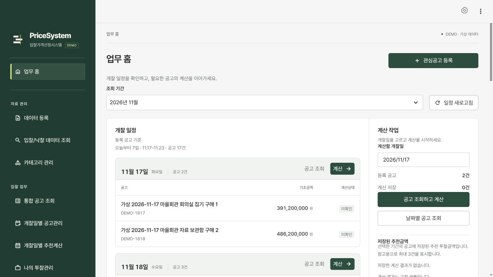
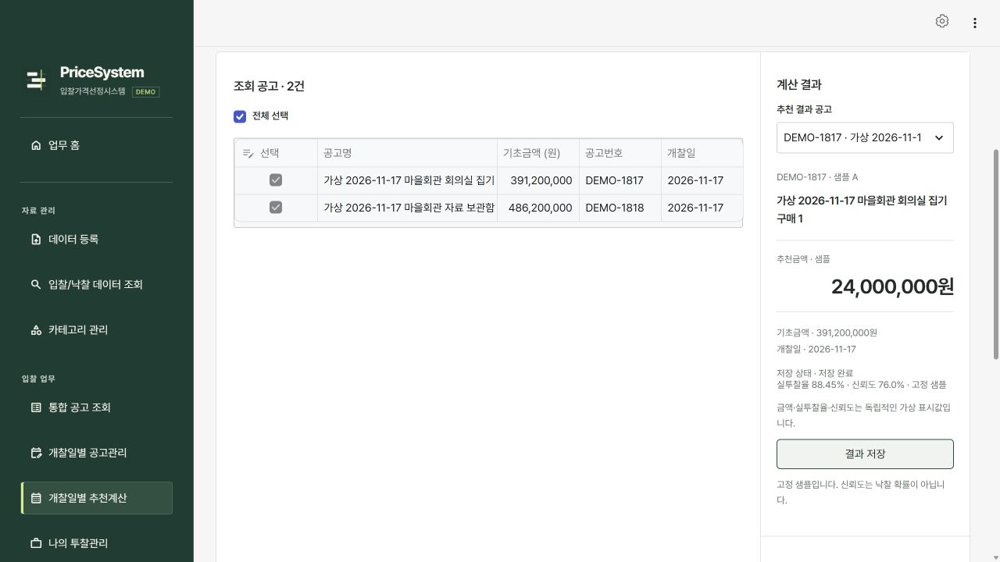
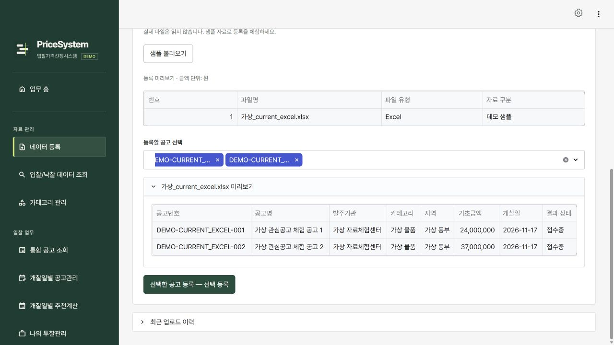
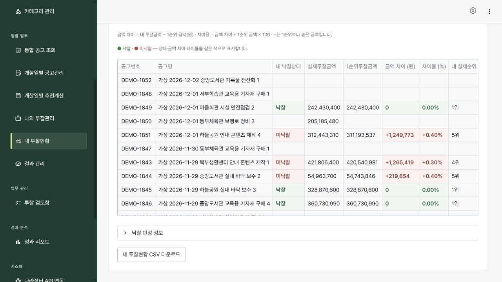
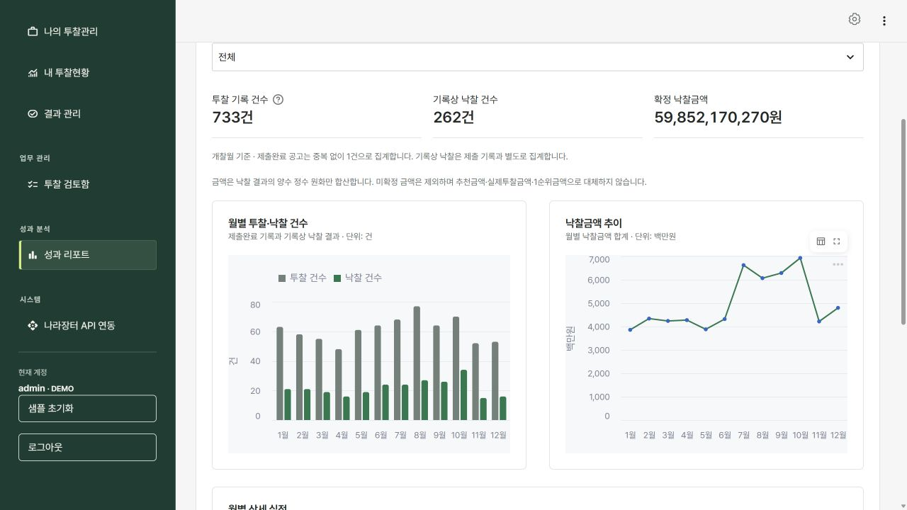

# PriceSystem

입찰 공고 조회부터 투찰 내역과 개찰 결과 관리까지 한곳에서 처리하는 입찰가격선정시스템의 포트폴리오 데모입니다.

**[온라인 데모 열기](https://demo.inhaaa.com/)** · 체험 계정 `admin` / `admin`

**기술 스택** · Python, Streamlit, pandas, SQLite

## 데모 체험

> 데모의 공고·투찰·낙찰 기록은 가상 데이터입니다. 추천금액과 분석 수치는 고정 샘플이며, 입력한 내용은 현재 세션에만 저장됩니다.

### 1. 업무 홈에서 개찰 일정 확인

조회 월을 고르면 날짜별 공고, 기초금액, 계산 상태를 확인할 수 있습니다. 각 날짜의 `공고 조회`나 `계산` 버튼으로 바로 이동합니다.



### 2. 관심공고 등록과 추천계산

`데이터 등록 → 관심공고`에서 `샘플 불러오기`를 누르고, 미리보기에서 공고를 선택해 등록합니다. `개찰일별 추천계산`에서는 대상 공고를 확인한 뒤 샘플 추천금액을 확인·저장합니다.



<details>
<summary>관심공고 등록 화면 보기</summary>



</details>

### 3. 투찰 검토와 결과 비교

`투찰 검토함`에서 자격, 서류, 금액, 마감 일정을 점검하고 검토 상태와 메모를 저장합니다. `나의 투찰관리`에서 투찰 내역을 기록한 뒤, `내 투찰현황`에서 낙찰 여부와 가상 1순위 금액 대비 차이를 확인합니다.

<details>
<summary>내 투찰현황 화면 보기</summary>



</details>

### 4. 월별 성과 확인

`성과 리포트`에서 기간과 카테고리를 고르고 월별 투찰·낙찰 건수와 낙찰금액 추이를 확인합니다. 상세 집계는 CSV로 내려받을 수 있습니다.

<details>
<summary>성과 리포트 화면 보기</summary>



</details>

## 운영 성과

실제 운영 시스템은 2026년 7월부터 입찰 업무에 활용됐으며, 운영 기간 중 낙찰 2건을 기록했습니다.

## 빠른 시작

저장소 폴더에서 `python -m venv .venv`로 Python 3.11 이상 가상환경을 만들고 활성화한 뒤 실행합니다.

```bash
python -m pip install -r requirements.txt
python -m streamlit run app.py
```

[개발 안내](docs/DEVELOPMENT.md) · [자산 및 권리 안내](ASSET_NOTICE.md)
