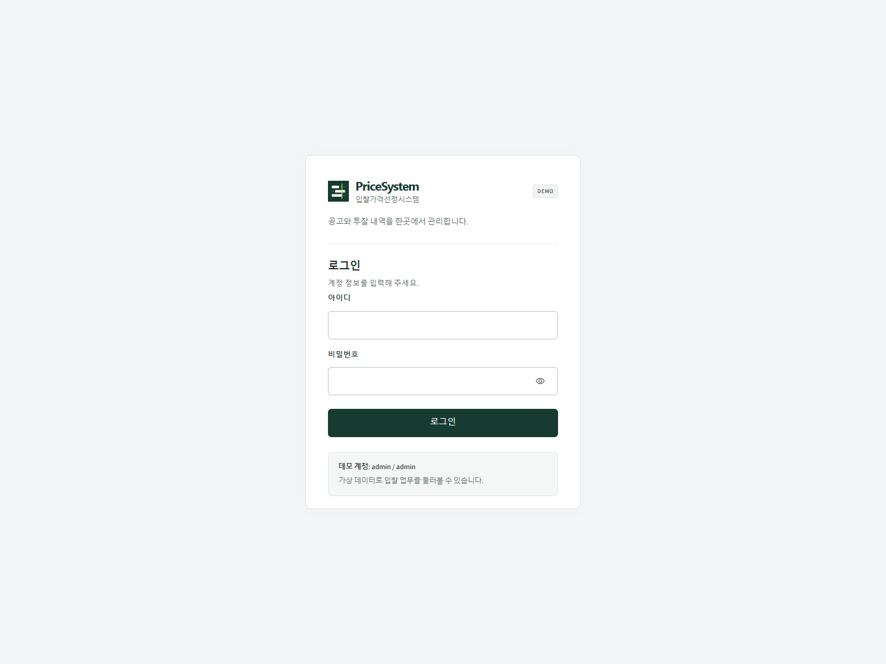
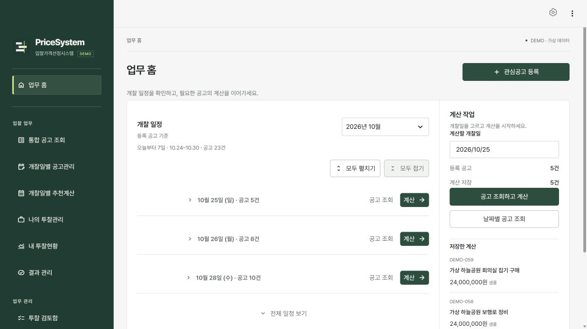
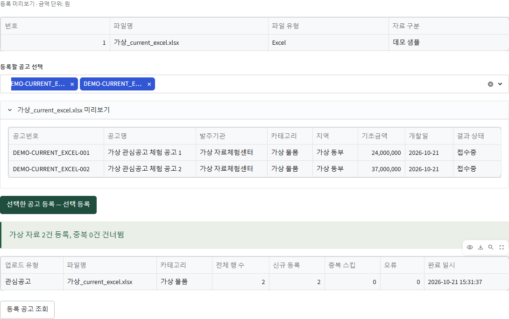
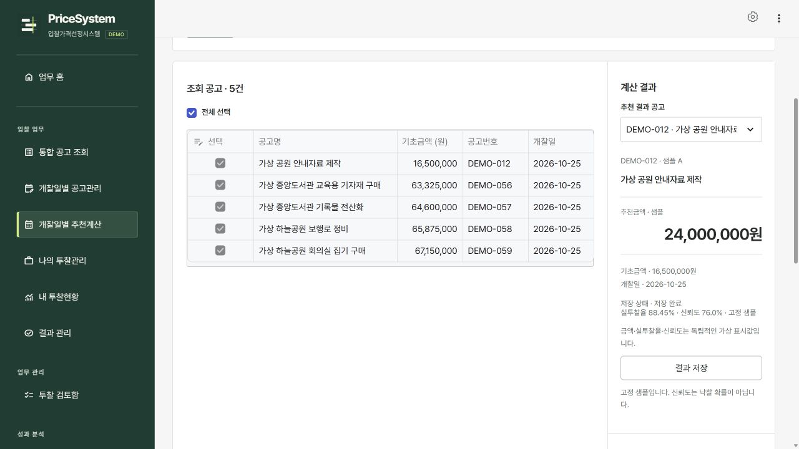
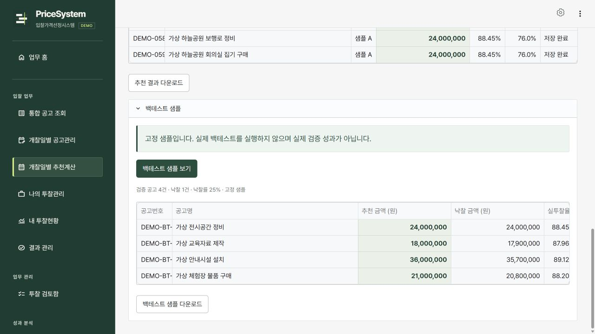
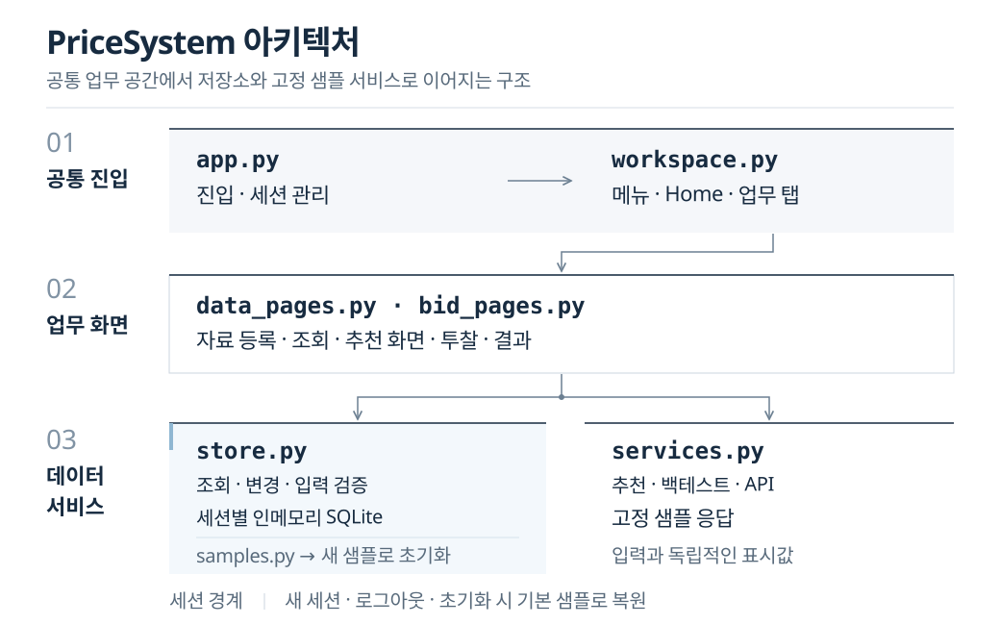

<div align="center">


# PriceSystem

### 입찰 업무의 흐름을 하나의 작업 공간으로

관심공고 등록 · 개찰일별 조회 · 추천계산

**Python · Streamlit · pandas · SQLite**

### [설치 없이 데모 체험하기 →](https://demo.inhaaa.com/)

체험 계정: `admin` / `admin`

[운영 성과](#운영-성과) · [화면 미리보기](#화면-미리보기) · [데모 체험](#데모-체험) · [빠른 시작](#빠른-시작) · [구현 포인트](#구현-포인트)

</div>

---

## 프로젝트 소개

PriceSystem은 공고와 관련 자료를 등록하고, 분석 화면을 거쳐 투찰 내역과 개찰 결과까지 관리하는 **입찰가격선정시스템**입니다. 실제 사용하는 운영 시스템의 화면 구성과 업무 흐름을 소개하기 위해, 독립적으로 실행할 수 있는 포트폴리오 데모를 만들었습니다.

이 저장소에서는 여러 업무 화면을 탭으로 오가며 공고를 검색하고, 가상 자료 등록과 투찰·결과 기록의 등록·수정·삭제를 체험할 수 있습니다. 기존 시스템의 화면 구성을 바탕으로 체험에 필요한 메뉴와 검색 조건을 정리하고, 운영 데이터와 비공개 기능에 연결되는 부분을 데모 전용 구성으로 분리했습니다.

### 운영 버전과 공개 데모의 차이

**현재 운영 중인 시스템에는 실제 추천 계산 로직, 정밀 분석 및 백테스트 기능이 구현되어 있습니다.** 해당 핵심 구현과 내부 판단 기준은 비공개로 유지하며, 이 공개 데모에는 포함하지 않았습니다.

| 구분 | 운영 시스템 | 공개 데모 |
| --- | --- | --- |
| 추천 계산·정밀 분석·백테스트 | 실제 계산·분석과 백테스트 수행 | 해당 로직 제외, 화면 시연용 고정 샘플로 대체 |
| 업무 데이터 | 실제 업무 데이터 사용 | 새로 만든 가상 데이터만 사용 |
| 체험 범위 | 실제 입찰 업무에 사용하는 시스템 | 화면 구성, 업무 흐름, 검색·필터·CRUD 체험 |

데모의 분석 화면은 결과를 확인하는 화면 구성과 조작 흐름을 보여줍니다. **표시되는 추천 값과 분석 결과는 실제 엔진에서 계산하거나 가져온 값이 아니며**, 운영 버전의 분석 수준이나 추천 성능을 나타내지 않습니다.

> **먼저 확인해 주세요**
>
> 모든 업무 데이터는 데모를 위해 새로 만든 가상 샘플입니다. 분석·추천과 API 응답은 **고정된 시연용 결과**이며, 실제 계산식이나 실제 엔진의 출력값을 사용하지 않습니다. 체험할 때에도 개인정보나 실제 업무 자료 대신 가상 정보를 입력해 주세요.

## 운영 성과

**2026년 7월 서비스를 오픈**하여 실제 입찰 업무에 활용하고 있으며, 운영 시스템 사용 기간에 아래 **낙찰 2건**을 기록했습니다.

| 시점 | 운영 이력 및 성과 |
| --- | --- |
| 2026-07 | 서비스 오픈 및 실제 업무 활용 시작 |
| 2026-07 | 낙찰 1건 발생 |
| 2026-09 | 낙찰 1건 발생 |

위 성과는 실제 운영 시스템의 사용 기간에 발생한 실적입니다. 공개 데모의 가상 데이터나 고정 추천 샘플로 산출한 결과가 아닙니다.

## 화면 미리보기

### 로그인

공개 체험 계정으로 시작하는 데모 로그인 화면입니다.



### 홈과 업무 공간

개찰일로 묶인 공고 일정을 확인하고, 해당 날짜의 공고 조회나 계산으로 바로 이동합니다. 기존 딥그린 메뉴는 유지하고, 본문은 흰 작업면과 옅은 회색 배경의 공고 작업대로 구성했습니다. 이전 일정은 접어두고 필요한 때 펼쳐볼 수 있습니다.



<details>
<summary><strong>자료 등록 화면 보기</strong> — 샘플 불러오기부터 선택 등록까지</summary>

관심공고 등록을 첫 화면에 두고 샘플 미리보기와 선택 등록을 제공합니다. 등록 후에는 해당 개찰일의 공고 조회로 이어집니다. 과거데이터와 개찰결과 자료도 보조 탭에서 이용할 수 있습니다.



</details>

### 개찰일별 추천계산

개찰일별 공고 목록에서 계산 대상을 고르고, 오른쪽 실행 패널에서 선택 확인·계산·저장을 진행합니다. 공고명·기초금액·개찰일을 우선 보여주며, 공고 상세 탐색을 거치지 않아도 됩니다. 좁은 화면에서는 목록과 실행 패널이 세로로 배치됩니다.



### 백테스트

같은 화면 아래의 **백테스트 샘플** 영역을 펼쳐 공고별 비교표를 확인하고 다운로드할 수 있습니다.



추천·신뢰도·백테스트 수치는 **고정된 가상 샘플**입니다. 운영 데이터나 실제 엔진의 계산·검증 결과를 사용하지 않습니다.

*모든 스크린샷은 이 데모의 가상 데이터로 촬영했습니다.*

## 데모 체험

[온라인 데모 열기](https://demo.inhaaa.com/)를 눌러 아래 계정으로 로그인하세요. 브라우저에서 설치 없이 체험할 수 있으며, 별도의 회원가입, API 키, 외부 DB는 필요하지 않습니다. 직접 실행하려면 [빠른 시작](#빠른-시작)을 참고하세요.

현재 대표 데모는 Hostinger VPS에서 독립적으로 실행합니다. 기존 [Streamlit Cloud 데모](https://pricesystem-demo.streamlit.app/)는 전환 확인용으로 유지하며, 중지·삭제는 별도 승인 후 진행합니다.

| 아이디 | 비밀번호 | 저장 방식 |
| :---: | :---: | --- |
| `admin` | `admin` | 현재 방문자의 세션 메모리에만 저장 |

처음에는 아래 순서로 둘러보는 것을 권합니다.

1. **관심공고 등록** — `데이터 등록 → 관심공고`에서 샘플을 불러오고 원하는 공고를 선택해 등록합니다.
2. **개찰일별 조회** — 등록 화면의 `등록 공고 조회` 또는 업무 홈의 날짜별 일정에서 해당 개찰일 공고를 불러옵니다.
3. **계산하고 저장** — `이 날짜 추천계산으로 이동`을 누른 뒤, 공고 선택을 확인하고 고정 추천 샘플을 계산·저장합니다.

투찰·결과 기록과 보조 자료 메뉴도 기존 왼쪽 메뉴에서 이용할 수 있습니다. `샘플 초기화`를 누르면 처음 상태로 돌아갑니다.

**투찰 전 검토 체험:** 왼쪽 `업무 관리 → 투찰 검토함`에서 공고를 선택하고 참가 자격·조건, 필수 서류, 투찰금액, 제출 일정을 확인합니다. 체크리스트·검토 상태·메모를 저장하면 상태별 건수와 목록에 반영됩니다. 네 항목을 모두 확인해야 `검토완료`로 저장할 수 있으며, 검토 상태는 실제 투찰의 제출 상태와 별개입니다. 저장 내용은 현재 세션에만 유지됩니다.

**성과 리포트 체험:** `성과 분석 → 성과 리포트`에서 조회 연도와 카테고리를 선택하면 월별 투찰·낙찰 건수, 낙찰금액 추이와 상세 표가 함께 바뀝니다. 2026년 5–10월의 가상 기록을 포함한 95개 공고를 제공하며, 기본 샘플의 제출완료 공고는 21건, 낙찰은 8건, 낙찰금액 합계는 116,500,000원입니다. 월별 실적 CSV를 내려받을 수 있으며, 집계는 현재 세션의 가상 기록만 사용합니다.

### 데이터는 얼마나 유지되나요?

화면을 이동하는 동안에는 같은 세션의 데이터를 사용합니다. 변경 사항은 다른 방문자의 데이터에 반영되지 않으며, 업무 DB 파일로 저장하지 않습니다. **새 세션·로그아웃·샘플 초기화 시 기본 샘플로 돌아갑니다.** 새로고침이나 재접속 후에는 변경 내용이 유지되지 않을 수 있습니다.

## 주요 기능

| 업무 | 화면 | 데모에서 확인할 수 있는 기능 |
| --- | --- | --- |
| 분류 관리 | 카테고리 관리 | 분류·설명 등록, 수정, 삭제 |
| 자료 준비 | 데이터 등록 | 과거데이터·관심공고·개찰결과의 샘플 미리보기와 선택 등록 |
| 공고 조회 | 통합 공고 조회 | 공고 검색, 목록과 상세 정보 조회 |
| 자료 조회 | 입찰/낙찰 데이터 조회 | 조건별 검색과 상세 자료 확인 |
| 일정별 공고 관리 | 개찰일별 공고관리 | 개찰일별 공고 조회와 관심 공고 관리 |
| 일정별 분석 | 개찰일별 추천계산 | 공고 선택·계산·저장 작업대, 추천금액·실투찰율·신뢰도 고정 샘플, 접힌 백테스트 영역 |
| 투찰 기록 | 나의 투찰관리 | 가상 회사의 투찰 기록 등록·조회·수정·삭제 |
| 투찰 전 검토 | 투찰 검토함 | 공고별 체크리스트·검토 상태·메모 저장, 검색·분류·상태 필터, 완료 조건 확인 |
| 현황 확인 | 내 투찰현황 | 투찰 기록과 낙찰·미낙찰·결과 대기 건수 조회 |
| 성과 분석 | 성과 리포트 | 연도·카테고리별 월간 투찰·낙찰 건수와 낙찰금액 추이, 상세 표와 CSV 다운로드 |
| API 화면 | 나라장터 API 연동 | 외부 호출 없이 정상·빈 결과·오류 샘플 응답 확인 |
| 결과 정리 | 결과 관리 | 결과 자료 등록, 수기 수정, 표시용 추천 결과 확인 |

**파일 등록 체험:** Excel/PDF 화면은 `샘플 불러오기 → 미리보기 → 선택 등록` 흐름을 제공합니다. 선택한 파일의 실제 내용을 판독하지 않습니다. 표 다운로드는 Excel에서 열 수 있는 CSV 형식으로 제공합니다.

## 구현 포인트

이 데모에서는 계산 방식보다 **화면 구성, 데이터 관리, 모듈 간 역할 분리**를 중심으로 구현 내용을 확인할 수 있습니다.

| 구현 주제 | 구성과 의도 | 관련 모듈 |
| --- | --- | --- |
| 여러 업무 화면의 연결 | 메뉴·그룹·다중 업무 탭과 홈을 공통 작업 공간에서 관리 | `demo/workspace.py` |
| 업무별 화면 분리 | 자료 등록·조회 화면과 투찰·결과 화면을 나누어 구성 | `demo/data_pages.py`, `demo/bid_pages.py` |
| 공통 화면 요소 | 반복되는 UI 표현과 테마를 공통 모듈로 관리 | `demo/ui.py`, `demo/visual_components.py`, `demo/workspace_theme.py` |
| 데이터 처리 분리 | 조회·등록·수정·삭제와 입력 검증을 저장소 모듈에 모음 | `demo/store.py` |
| 방문자별 체험 공간 | 세션별 인메모리 SQLite로 데이터와 초기화 범위를 분리 | `app.py`, `demo/store.py` |
| 독립적인 샘플 서비스 | 분석·API 샘플과 가상 초기 데이터를 별도 구성 | `demo/services.py`, `demo/samples.py` |

### 구성 흐름



모듈의 상세 역할과 세션 경계는 [아키텍처 안내](docs/ARCHITECTURE.md)에 정리했습니다. 확인된 원본의 모듈 개발 기록과 데모 작업 범위는 [개발 안내](docs/DEVELOPMENT.md)에서 구분해 볼 수 있습니다.

## 빠른 시작

**Python 3.11 이상**과 Git이 필요합니다. 아래 명령으로 저장소를 받은 뒤 운영체제에 맞게 실행하세요. 주요 의존성은 `requirements.txt`에 고정되어 있습니다.

```bash
git clone https://github.com/inhaaa/PriceSystem-demo.git
cd PriceSystem-demo
```

### Windows PowerShell

```powershell
python -m venv .venv
.\.venv\Scripts\python.exe -m pip install -r requirements.txt
.\.venv\Scripts\python.exe -m streamlit run app.py
```

### macOS · Linux

```bash
python3 -m venv .venv
.venv/bin/python -m pip install -r requirements.txt
.venv/bin/python -m streamlit run app.py
```

터미널에 표시되는 로컬 주소를 브라우저에서 열고 `admin` / `admin`으로 로그인합니다. 설치 없이 둘러보려면 [온라인 데모](https://demo.inhaaa.com/)를 이용하세요.

### VPS 독립 배포

Docker와 Caddy로 `https://demo.inhaaa.com`에 배포한 구성 및 Hostinger Webconsole 명령은 [VPS 배포 안내](docs/DEPLOYMENT.md)에 정리했습니다. 별도 Compose 프로젝트 `pricesys-demo`가 `127.0.0.1:8502`만 사용하며, 데이터는 기존과 동일하게 세션 메모리에 저장합니다.

VPS에 [자동배포](docs/AUTO_DEPLOYMENT.md)를 설치하고 timer를 활성화했습니다. `main` push 후 약 1분 간격으로 변경을 확인하고, 빌드·테스트를 통과하면 데모만 갱신합니다. 화면·업무 코드 수정 후에는 Webconsole에서 별도 배포 명령을 실행할 필요가 없습니다.

### 테스트 실행

가상환경을 활성화한 상태에서 실행합니다.

```bash
python -m unittest discover -s tests -t . -v
```

`tests/`에서는 CRUD, 입력 검증, 세션 초기화, 화면 동작 및 고정 샘플 서비스의 경계를 확인합니다. 실제 분석 엔진의 정확도나 운영 성능을 평가하는 테스트는 포함하지 않습니다.

## 공개 범위

| 이 저장소에 포함된 내용 | 비공개로 유지하는 내용 |
| --- | --- |
| 검토된 화면 구성·메뉴·공통 시각 요소 | 운영용 계정·권한·회사 설정 |
| 가상 데이터의 검색·필터·CRUD | 실제 사용자·회사·투찰·낙찰 데이터 |
| 명확히 표시한 분석·추천 고정 샘플 | 실제 계산식·가중치·보정값·판단 기준·백테스트 구현 |
| 외부 통신 없는 API 샘플 응답 | 실제 API 키·인증정보·외부 연동 설정 |
| 세션별 메모리 저장소와 테스트 | 운영 DB·백업·로그·운영 환경 설정 |

원본 운영 시스템의 개발 이력은 Private 저장소에 유지하며, 이 저장소는 데모 전용 이력으로 관리합니다. 원본 프로젝트나 비공개 모듈 없이 실행할 수 있고, 실제 계산으로 전환하는 설정이나 운영 경로 연결도 포함하지 않습니다.

## 더 알아보기

- [아키텍처 안내](docs/ARCHITECTURE.md) — 모듈별 역할, 데이터 흐름, 세션 경계
- [개발 안내](docs/DEVELOPMENT.md) — 확인된 개발 기록, 수정 위치, 검증 방법
- [자산 및 권리 안내](ASSET_NOTICE.md) — 코드·문서·디자인과 제3자 의존성의 이용 범위

포트폴리오 열람·평가와 데모 체험을 목적으로 공개합니다. 저장소 전체에 MIT 등의 포괄적 라이선스를 부여하지 않으며, 디자인 자산과 제3자 소프트웨어에는 각각의 권리와 이용 조건이 적용됩니다.
